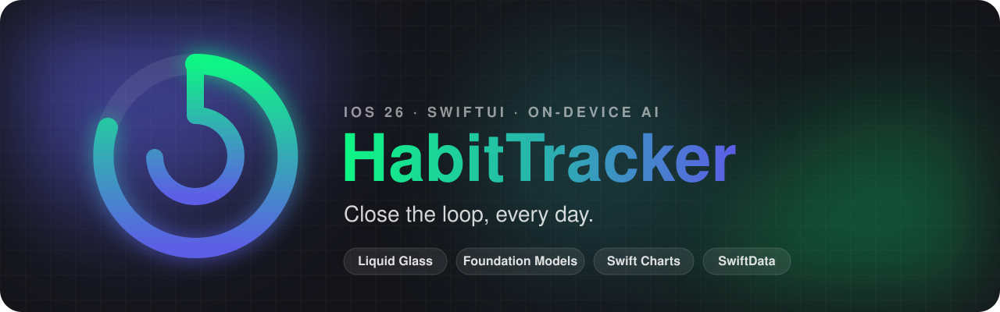
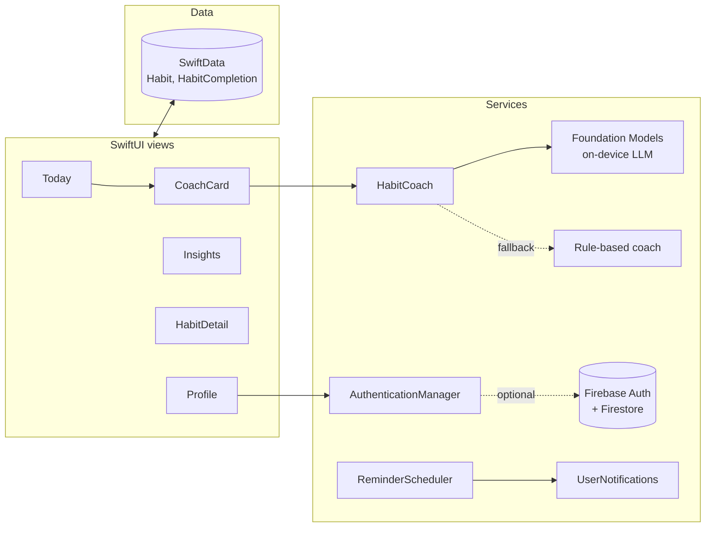

<p align="center">
  
</p>

<p align="center">
  <a href="https://github.com/flawnull/habit-tracker/actions/workflows/build.yml"></a>
  
  
  
  
  
</p>

<p align="center">
  A native iOS habit tracker with an <b>on-device AI coach</b>, GitHub-style activity heatmaps and a full Liquid Glass interface.<br>
  Runs out of the box. Firebase accounts are optional.
</p>

---

## Highlights

| | |
|---|---|
| **On-device AI coach** | Uses Apple's [Foundation Models](https://developer.apple.com/documentation/foundationmodels) framework with guided generation (`@Generable`) to write a short note from your real streaks. The model runs locally on Apple Intelligence devices, so there is no API key, no network call and no data leaves the phone. Other devices fall back to a rule-based coach. |
| **Liquid Glass UI** | Every surface uses the iOS 26 `glassEffect` material over an animated `MeshGradient` background. The tab bar minimises on scroll. Light and dark themes both ship. |
| **Insights** | Swift Charts for the daily trend (7, 30 or 90 days), best weekday and a weekly line per habit. An 18-week contribution heatmap shows the whole picture. |
| **Backfill from the heatmap** | Forgot to log yesterday? Tap any past day on a habit's heatmap to add or remove the check-in. |
| **Streaks, XP and achievements** | Correct streak maths (deduplicated by day, today stays "open" until midnight), player levels and six unlockable badges. |
| **Daily reminders** | A real local notification at the time you pick, via `UserNotifications`. |
| **Demo mode** | Clone, open, run. Without `GoogleService-Info.plist` the app skips sign-in and stores everything locally. One tap in Settings loads ten weeks of demo data. |

## Screens

| Today | Insights | Habit detail | Profile |
|---|---|---|---|
| Progress ring, week strip, AI coach card, one-tap check-ins with confetti on a perfect day | Stat tiles, trend chart, heatmap, best weekday, leaderboard | Stats, tap-to-backfill heatmap, 12-week trend | Level and XP bar, achievements, settings |

<!--
Drop simulator screenshots in docs/screenshots/ and uncomment:
<p align="center">
  
  
  
  
</p>
-->

## Quick start

Requirements: **Xcode 26** and an iOS 26 simulator or device.

```bash
git clone https://github.com/flawnull/habit-tracker.git
cd habit-tracker
open habit-tracker.xcodeproj
```

Press <kbd>⌘</kbd> <kbd>R</kbd>. Swift Package Manager resolves Firebase on first build.

With no Firebase config the app starts in **local demo mode**. Tap **Start tracking**, then go to **Profile → Settings → Load demo data** to fill every chart.

To try the AI coach, run on a Mac or iPhone with Apple Intelligence turned on. The coach card shows an "On-device" badge when the model is in use and the reason when it is not.

### Optional: accounts with Firebase

Accounts add email sign-up, sign-in and password reset. Habits stay local either way.

1. Create a Firebase project, add an iOS app with bundle ID `com.habit-tracker` (or change it in Xcode).
2. Enable **Authentication → Email/Password** and create a **Firestore** database.
3. Download `GoogleService-Info.plist` into the repo root, next to `AppDelegate.swift`.
4. Deploy the included [`firestore.rules`](firestore.rules).

A build phase copies the plist into the app when it exists and prints a warning when it does not. The file is git-ignored. Full walkthrough: [FIREBASE_SETUP.md](FIREBASE_SETUP.md).

## Architecture



```
habit-tracker/
├── AppDelegate.swift            App entry, optional Firebase boot, model container
├── ContentView.swift            Tab bar
├── Models/
│   ├── Habit.swift              @Model types, streak and rate maths, toggle logic
│   └── SampleData.swift         Seeded demo history + preview container
├── Managers/
│   ├── AuthenticationManager.swift   Firebase auth, guest mode, AppConfig
│   ├── HabitCoach.swift              Foundation Models coach + fallback
│   └── ReminderScheduler.swift       Daily local notification
├── Views/
│   ├── DesignSystem.swift       Theme, glass cards, buttons, rings, shared components
│   ├── TodayView.swift          Hero ring, week strip, coach card, habit cards
│   ├── StatisticsView.swift     Charts, heatmap, leaderboard
│   ├── HabitDetailView.swift    Per-habit stats, backfill heatmap, weekly trend
│   ├── AddHabitView.swift       Create and edit sheet
│   └── ...                      Auth, profile, settings, about, support
└── firestore.rules
```

### How the coach prompt works

`CoachSnapshot` turns the user's habits into plain values (name, done today, current and best streak, 30-day rate). `HabitCoach` sends that to a `LanguageModelSession` with short instructions and asks for a `CoachInsight`, a `@Generable` struct with `headline`, `message` and `tip` fields. Guided generation means the model returns typed Swift values, not text to parse. Generation is debounced so a burst of check-ins triggers one request.

## Roadmap

- [ ] Home Screen and Lock Screen widgets with interactive check-in
- [ ] Weekly targets (the `frequency` and `targetDays` fields are already in the model)
- [ ] iCloud sync through SwiftData + CloudKit
- [ ] App Intents so Siri and Shortcuts can log habits
- [ ] Unit tests for streak and rate maths

## License

MIT. See [LICENSE](LICENSE).
